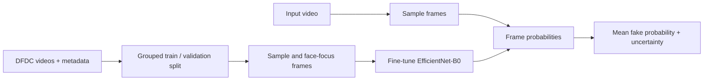

# Deepfake Video Detector

> **Research demo, not a verification tool.** A score is not proof that a video is authentic or fake. Performance can drop on new generators, editing pipelines, compression, and footage unlike the training data. Do not use this model as the sole basis for consequential decisions.

## What it does

- Reads DFDC `metadata.json` labels or infers labels from DFD's real/fake folder names.
- Splits related originals and fakes together to reduce train/validation leakage.
- Fine-tunes a pretrained EfficientNet-B0 using several frames per video.
- Optionally centers each frame on its largest detected face, falling back to the full frame.
- Selects checkpoints using video-level validation metrics and early stopping.
- Offers both a command-line interface and a local Streamlit upload demo.


## Quick start

Use Python 3.10 or newer. The project selects CUDA when available, then Apple's MPS backend, then CPU. On an Apple Silicon Mac, install a current PyTorch build with MPS support; see the [PyTorch MPS guide](https://docs.pytorch.org/docs/stable/notes/mps.html).

From the repository root:

```bash
python -m venv .venv
source .venv/bin/activate       # Windows: .venv\Scripts\activate
python -m pip install --upgrade pip
pip install -r requirements.txt
pip install -e .
```

The first training run downloads the pretrained EfficientNet-B0 ImageNet weights through Torchvision.

## Get the data

The video datasets are not included in this repository. For the [DFD dataset you shared](https://www.kaggle.com/datasets/sanikatiwarekar/deep-fake-detection-dfd-entire-original-dataset), extract the videos so their parent folders identify the class:

```text
data/dfd/
├── DFD_original sequences/
│   └── ... .mp4
└── DFD_manipulated_sequences/
    └── ... .mp4
```

The loader also supports DFDC: accept its [competition rules](https://www.kaggle.com/competitions/deepfake-detection-challenge/rules), get the data from the [competition page](https://www.kaggle.com/competitions/deepfake-detection-challenge/data), and extract videos alongside their `metadata.json` files. The loader searches recursively and reads `REAL`/`FAKE` labels and original-video links. For folder-labeled data, it looks for `original`/`real` and `manipulated`/`fake` names in a video's parent folders. Keep all data under `data/`; it is ignored by Git. Follow the dataset page and upstream source terms for use and redistribution.

## Train

```bash
python -m deepfake_detector.train \
  --data-dir data/dfd \
  --output artifacts/sample_model.pt \
  --max-videos 120 \
  --epochs 5 \
  --batch-size 2 \
  --frames-per-video 2 \
  --num-workers 0
```

Point `--data-dir` at the extracted DFD folder tree or a DFDC folder containing `metadata.json` and MP4 files. `--max-videos` creates a class-balanced subset; where metadata links fakes to originals, it keeps those videos together. It limits training work, but does not reduce the amount you need to download. A 120-video cap is useful for checking the workflow, but is too small to establish real-world accuracy. For a larger run, remove `--max-videos` and increase `--epochs`, `--batch-size`, and `--frames-per-video` as your memory allows.

Training samples multiple random frames from each video in every epoch. Validation uses evenly spaced frames and averages their logits, matching the video-level prediction path. A grouped split keeps each fake with its source original when metadata identifies it; class-weighted loss, a learning-rate scheduler, and early stopping help with class imbalance and overfitting. Face crops use OpenCV's frontal-face detector and fall back to the full frame when no face is found. Pass `--no-face-crop` to disable this step.

The best checkpoint is selected by validation ROC-AUC. The run also reports average precision and balanced accuracy. These are development metrics on a small holdout, not proof of generalization. A small sample may not contain enough independent identities or manipulation types for a meaningful accuracy estimate.

## Predict on a video

```bash
python -m deepfake_detector.predict \
  --checkpoint artifacts/best_model.pt \
  --video path/to/video.mp4 \
  --frames 16
```

Example output:

```json
{
  "video": "video.mp4",
  "prediction": "potentially_manipulated",
  "fake_probability": 0.82,
  "frame_count": 16,
  "frame_score_std": 0.11
}
```

Score a directory of videos and write a CSV:

```bash
python -m deepfake_detector.predict \
  --checkpoint artifacts/best_model.pt \
  --video-dir path/to/videos \
  --output-csv predictions.csv
```

The probability is the model's estimate for the `FAKE` class. `frame_score_std` summarizes variation across sampled frames; it is not a calibrated confidence interval.

## Run the demo

```bash
pip install -e '.[demo]'
streamlit run app.py
```

Choose a local checkpoint and upload an MP4. The app processes the video locally in the Streamlit process and does not send it to an external service. Do not expose the app to a network you do not control.

## Method and scope

The image backbone starts from Torchvision's ImageNet-pretrained EfficientNet-B0. It is fine-tuned on multiple frames from each video using DFD folder labels or DFDC `REAL` and `FAKE` metadata. When enabled, face crops focus the model on the largest face detected in each frame. At training, validation, and inference, frame logits are averaged to form a video-level score. This matches training to the way predictions are made and reduces reliance on a single sampled frame.

This is a compact baseline, not a state-of-the-art forensic system. Face crops use a simple frontal-face detector; faces are not tracked or aligned, and the model does not compare audio and video. Better sampling and preprocessing are intended to make the baseline more reliable, but do not guarantee higher accuracy. Dataset bias, subject overlap, video compression, and distribution shift can all affect results. No benchmark score is included because this repository has not been evaluated on a held-out test set.

## Data and model notes

- DFDC is subject to the [Kaggle competition rules](https://www.kaggle.com/competitions/deepfake-detection-challenge/rules); obtain it directly from Kaggle and do not commit it here.
- [DFD on Kaggle](https://www.kaggle.com/datasets/sanikatiwarekar/deep-fake-detection-dfd-entire-original-dataset) is also not included. Review the dataset page and upstream source terms before sharing data or model artifacts.
- Torchvision's pretrained weights retain their own terms. Review the relevant upstream terms before redistributing checkpoints.
- This repository contains no trained checkpoint, dataset, or claim of validated accuracy.

See [MODEL_CARD.md](MODEL_CARD.md) for intended use, evaluation status, and known limitations.

## Acknowledgments

- [DeepFake Detection Challenge (Kaggle)](https://www.kaggle.com/competitions/deepfake-detection-challenge)
- [Deep Fake Detection (DFD) dataset on Kaggle](https://www.kaggle.com/datasets/sanikatiwarekar/deep-fake-detection-dfd-entire-original-dataset)
- [Torchvision models](https://pytorch.org/vision/stable/models.html)

## License

No project license has been selected yet. Add one before accepting outside contributions or publishing the source for reuse. Dataset and pretrained-weight terms are separate from the project source license.
